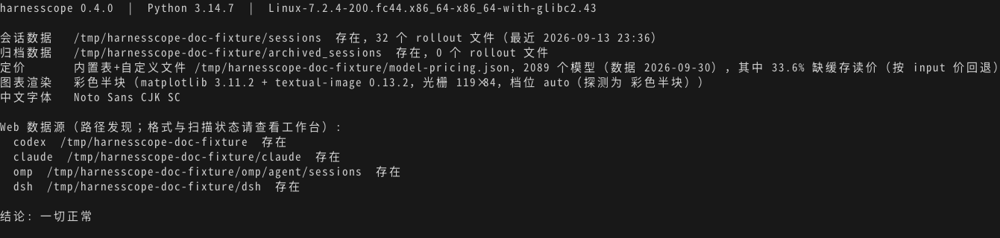

# codex-usage

[](https://github.com/stofancy/codex-usage/actions/workflows/ci.yml)
[](pyproject.toml)
[](LICENSE)

[English](README.md) · **中文**

本机个人用量分析，支持 **Codex、Claude、OMP（oh my pi）、DSH（deepseek harness）**。运行 `codex-usage --web`，在 PC 浏览器查看用量、估算费用、时间趋势与维度贡献。现有 Codex 终端报表、图表和 JSON 继续可用。

图表默认出**真图**：[matplotlib](https://matplotlib.org/) 渲染 PNG 后由 [textual-image](https://github.com/lnqs/textual-image) 送进终端——支持图形协议（kitty / Sixel）的终端直接显示图片，其余终端显示彩色半块字符；装了可选依赖且输出是终端时才会启用。未装依赖、输出被管道重定向或加 `--ascii` 时，回退到字符画（[plotext](https://github.com/piccolomo/plotext) + [termcharts](https://github.com/zvovcahovo/termcharts)）。

源文件保持只读；网页版维护自有、可重建的 SQLite 统计索引，在 loopback 提供随包静态资源，普通查询无需访问外网。`codex-usage --update-pricing` 显式下载公开价格。估算费用采用内置表、价格缓存和 `CODEX_USAGE_PRICING_FILE` 覆盖值，详见[定价](#定价)。网页分别展示已知估算小计与缺价覆盖，真实账单未知。旧 Codex 报表沿用 `$0*` 的缺价展示约定，`*` 表示费用未知。

## 为什么是它

- **四种 harness 的本机工作台**：按来源、模型、项目、会话、用途等已记录维度分析，覆盖状态说明缺字段与解析失败。
- **聚合看板与用量明细**：Dashboard 查看消耗、速率、缓存、计时与贡献；独立明细入口按请求、会话、轮次、模型或 Harness 查看用量。两者共享时间和筛选，支持亮暗主题。
- **费用与效率有清楚口径**：已知估算金额、缺价覆盖、缓存率、每调用成本和每百万 tokens 成本注明计算范围；用量日志没有产出质量信息，不推断模型性价比。
- **保留现有 Codex CLI**：会话 / 子代理 / 家族报表、筛选、图表、TPS、JSON 继续可用；`--schema` 描述命令契约，`--doctor` 诊断环境及四源路径发现；路径存在仅表示发现来源，无法证明解析覆盖。
- **数据留在本机**：无遥测，源文件只读，网页服务与统计索引在本机运行；HTTP 与同机进程边界见 [SECURITY.md](SECURITY.md)。

[2026-09-27 研究文档](docs/research/2026-09-27-harness-usage-proposal.md) 保留历史竞品对照与本次实施基线。CodeBurn、New API 的参考重点是维度、筛选与时间线，浏览器界面独立设计。

## 安装

要求 **Python ≥ 3.10**。

```bash
uv tool install codex-usage                                          # 最新已发布版本
uv tool install "git+https://github.com/stofancy/codex-usage[image]" # 可选：加终端真图图表
```

网页工作台当前属于 **Unreleased** 源码版本。安装本次 checkout 时，先构建随包网页资源：

```bash
cd web
npm ci
npm run build
cd ..
uv tool install --force .
codex-usage --web
```

开发与浏览器验收使用 Node.js 22.x >=22.22.3 或 >=24.8.0，以及 npm；安装后的工作台只需 Python 运行时。

可选 extras `[image]` 会装上 matplotlib 与 textual-image，其中 `textual-image` 要求 **Python ≥ 3.12**；Python 3.10/3.11 下图表保持字符画，其余功能不受影响。未装 extras、输出不是终端或加 `--ascii` 时，图表自动回退字符画。

## 网页用量工作台

```bash
codex-usage --web
codex-usage --web --port 8766   # 指定本机端口
```

打开命令打印的本机地址（默认 `http://127.0.0.1:8765`）。启动时会后台扫描来源，后续变化通过工作台的刷新操作重新扫描。浏览期间保留前台进程，按 Ctrl-C 退出并释放端口；关闭浏览器标签页后进程继续运行。

网页采用共享的多源事件查询层与自有统计索引。下面的现有报表参数继续读取 Codex 会话，终端报表尚未迁移为四源输出契约。

Dashboard 首屏显示估算费用、Tokens、模型调用和轮次。主消耗趋势与模型 / 项目 / 来源
排行相邻，请求速率、缓存、执行速度和工具聚合面板提供进一步分析。面板菜单可选指标、
分组、区域 / 折线 / 柱形及比较成员。点击图表数据点或框选时段会缩小全局窗口，范围返回
操作恢复上一视图。页头可切换亮色与暗色，选择保存在当前浏览器。

全局时间可直接输入 `-18h`、`-2days` 等相对表达式、固定起点**截至现在**，以及固定历史起止。
起止输入各自支持表达式和具体时间，也可点击各自的日历图标选择日期时间，精确到秒；可混合使用，点击“应用”后生效。
显示与分桶采用本机时区，统计间隔通过分段按钮直接切换。滚动范围在刷新后重新计算，
历史范围和图表缩窗保持原值。自动刷新有独立开关与周期选择，先增量读取来源再更新页面；
默认关闭，避免重叠，后台标签页和编辑时间时暂停。时间模式、刷新间隔、筛选与面板偏好
保存在当前浏览器，重载后恢复。来源健康在页底独立折叠查看。

全部面板与用量明细共用范围、统计间隔和全局筛选。可组合来源、模型、项目、provider、
用途条件，更多条件包含代理类型、运行模式与会话。Codex 模式显示标准、Fast 或未记录。
局部图表调整与明细翻页只重载相关数据。

**用量明细** 是独立入口，可切换逐次请求或按会话、轮次、模型、Harness 汇总，展示输入
（未缓存）、缓存命中、输出、缓存写入、估算费用与可靠计时。响应 TPS 和轮次 TPS 分开，
缺失计时保留为空。分组前先按请求发生时间入选，排序覆盖全部匹配结果后再分页。
会话行用 Harness、项目和可见短 ID 辨认；下钻保持筛选上下文。来源未记录的结束时间
保持未知，历史未闭合轮次需要窗内活动证据才会入选。缺价与缺分量保留相应标识。

### 来源发现与覆盖

| Harness | 默认来源 | 覆盖配置 |
|---|---|---|
| Codex | `~/.codex/sessions`、`~/.codex/archived_sessions` | `CODEX_HOME` 指定网页来源根目录 |
| Claude | `~/.claude/projects/**/*.jsonl` | `CLAUDE_CONFIG_DIR` |
| OMP | `~/.omp/agent/sessions/**/*.jsonl` | `OMP_SESSIONS_DIR`，或 `PI_CODING_AGENT_DIR` 下的 `/sessions` |
| DSH | `~/.dsh/sessions` | `DSH_HOME` 指定 DSH 根目录 |

网页统计索引为 `~/.cache/codex-usage/usage.sqlite3`，可用 `CODEX_USAGE_CACHE_DIR`
更改目录。旧 Codex 报表继续使用 `CODEX_USAGE_SESSIONS_DIR`、`CODEX_USAGE_ARCHIVE_DIR`
覆盖路径。

Claude 读取 assistant 用量与 advisor iterations，保留已记录的缓存读写分量；日志缺失时
provider 与逐调用计时未知，会话汇总费用不会叠加进事件费用。OMP 包含 assistant 与
`model_usage` 用量、原始用途和模型计时。DSH 读取会话最高 generation，支持当前 v4
compact stream 与带 usage 的 assistant attempt；title/search 请求日志缺少结算用量，
无法据此统计 tokens。DSH 压缩来源由随包 Python `zstandard` 依赖读取，无需另装系统解压包。
最新 generation 不受支持时显示读取失败，保留诊断，不自动替换为旧 generation。

覆盖状态显示扫描结果、解析警告 / 错误与缺价范围；部分覆盖保留可用统计并说明未计记录。
DSH interrupted / error turn 的已记录 tokens 保留，计时排除出完整 turn TPS；Claude 本地
全零 `<synthetic>` 消息不计为 API 调用。来源记录的成本仍属估值，真实账单未知。
父子关系与复制历史按实际来源证据处理；索引与 API 不含会话正文、prompt 和凭据。

### 共享分析 JSON

```bash
codex-usage --analytics --query 'harness=codex&group_by=model&metric=tokens'
```

`--analytics` 刷新统计索引，查询与网页共用的多源分析层并输出 JSON。筛选通过
`--query` 指定；此入口会拒绝旧 `--since`、`--model` 和报表布局参数。

| 查询参数 | 值与含义 |
|---|---|
| `start`、`end` | 同时提供，带 UTC offset 的 ISO 8601 时间；包含 start，排除 end |
| `timezone` | 分桶的 IANA 时区，默认 `UTC` |
| `bucket` | `auto`、`second`、`5second`、`10second`、`30second`、`minute`、`5minute`、`15minute`、`hour`、`day`、`week`、`month` |
| `group_by` | 1–3 个逗号分隔的维度 |
| 维度 / 筛选 | `harness`、`model`、`provider`、`project`、`agent_type`、`purpose`、`service_tier`、`session`；同维度重复传值表示任选其一 |
| `metric` | `cost_usd`、`tokens`、`calls`、`input`、`output`、`cache_read`、`cache_write`、`cache_hit_rate`、`cost_per_call`、`cost_per_mtok`、`tpm`、`rpm`、`throughput_tps`、`rps` |
| `member` | 可重复，指定当前分组中的趋势成员 |

八个维度包含代理类型与服务档位。来源自报总量及其覆盖单列展示，并保留与已记录 token
分量总计的差异；额外分量和 TTL / reasoning 子集不重复累加。

所选调用有缺价时，每调用成本和每百万 tokens 成本返回未知；缓存写入量未知时，
缓存命中率返回未知。用量按已记录分量统计，无事件桶与缺失数据分别表达。
TPS 按 harness 与计时定义分别提供。完整响应与比较语义见[工作台 API 文档](docs/workbench-api.md)。

本机 API 提供 GET `/api/status`、`/api/analytics`、`/api/sessions`、
`/api/sessions/{harness}/{sid}`、`/api/turns`。单轮详情使用
`/api/turns/detail?harness=...&session_id=...&turn_id=...`，每个参数值须 URL 编码。
会话与轮次列表支持 `offset`、`limit`（1–200）。轮次支持
`sort=start|cost_usd|tokens|duration|calls|tool_calls` 和 `order=asc|desc`，
未知值排最后，排序覆盖完整结果后再分页。
POST `/api/refresh` 携带 `Content-Type: application/json`，显式启动后台扫描。
查询响应注明快照，读取查询不重扫源文件。

### 速率、计时、轮次与工具口径

| 指标 | 分母与范围 |
|---|---|
| TPM / RPM | 已记录 tokens / 模型调用数除以实际覆盖秒数，再乘 60 |
| 每秒平均吞吐 / RPS | 已记录 tokens / 模型调用数除以实际覆盖秒数，包含空闲时间 |
| 可靠计时输出 TPS | 输出 tokens 除以可靠样本的完整耗时，按 harness 与计时定义分别展示 |
| 轮次 P50 / P95 | 完整落窗、已闭合且有起止时间的轮次耗时分位数，保留 exact / inferred 样本数 |

首尾不完整切片使用与全局时间窗交集的实际秒数。`auto` 选择约 120 桶以内的粒度，
自动最细为分钟；显式细粒度受 2000 桶上限约束。速率反映持久用量记录在窗口中的平均强度，
无法据此恢复供应商限额或瞬时 token 流。可靠计时样本按完成时间入桶并保留完整耗时，
缺计时保持未知。

会话、轮次、模型调用与工具调用分别计数，一轮可包含多模型、多次工具执行。
窗内小计保留当前范围的匹配事件；完整落窗、已闭合且有已记录调用的轮次提供整轮已记录
小计与每轮均值。从 iteration 推导的边界标为 `inferred`，保留数据并显示 exact / inferred
样本数。已知小计均值沿用这些合格轮次作为分母，并显示组成与定价覆盖；完整值均值在
组成或价格缺失时保持未知，全部缺价的费用保持未知。运行中、失败、中断和窗口截断轮次
保留身份与窗内小计。整轮已记录指标仍使用当前模型调用筛选范围，无法证明供应商未记入
日志的调用与费用已完整捕获。

工具统计只保留名称、调用身份、状态与时间戳，按身份去重。覆盖 partial / unknown 时
保留已记录小计，总调用数与每轮比率保持未知。模型 / provider / 用途 / 档位筛选选中匹配
模型调用及其轮次，工具仍描述这些轮次已记录的工具调用。详情标明调用在全局窗口内外，
并保留缺价信息；索引与 API 不含工具参数、结果正文、聊天正文或凭据。

## Codex CLI 使用

```bash
codex-usage                                          # 今天的会话明细（含子代理，每会话一行）
codex-usage --by-model                               # 按模型聚合（每模型一行，含会话数）
codex-usage --by-day --since 2026-09-04              # 按天聚合
codex-usage --by-day --by-model --since 2026-09-04   # 天×模型
codex-usage --family --parent 01a083b7 --since 2026-09-09     # 家族树：主线程+各子代理
codex-usage --family --by-model --since 2026-09-09            # 家族×模型
codex-usage --raw --type subagent                    # 文件粒度：每个子代理文件一行
codex-usage --since "2026-09-11 09:00" --until "2026-09-11 14:00"   # 分钟级时间过滤
codex-usage --by-model --since 20260912-161023       # 紧凑时间：同 2026-09-12 16:10:23
codex-usage --by-model --since 20260912-16           # 紧凑时间：同 2026-09-12 16:00
codex-usage --chart pie                              # 饼图：各模型成本分布
codex-usage --chart bar --by-day --by-model --metric total   # 堆叠柱状图
codex-usage --chart area --by-day --metric cache     # 面积图：每天缓存读趋势
codex-usage --chart bar --by-day --ascii             # 强制字符画（默认终端下优先真图）
codex-usage --json                                   # 机器可读输出（含按模型明细）
codex-usage --help                                   # 自说明帮助（/? 、-? 、help 等价）
codex-usage --schema                                 # 机器可读自描述（JSON 契约）
codex-usage --doctor                                 # 环境自检（数据源/定价/真图能力）
codex-usage --update-pricing                         # 显式从外网下载价格
```

### 时间格式

`--since` / `--until` 支持两种写法，可混用：

| 写法 | 示例 | 含义 |
|---|---|---|
| 显式 | `2026-09-12`、`2026-09-12 16:10`、`2026-09-12T16:10:23` | 常规格式 |
| 紧凑 | `20260912`、`20260912-16`、`20260912-1610`、`20260912-161023` | `YYYYMMDD[-时[分[秒]]]`，分隔符也可用空格 `.` `T`，时间可写 `16:10:23` |

缺省部分 `--since` 补 0（如 `20260912-16` → 16:00:00）、`--until` 补满（→ 16:59:59，纯日期 → 23:59:59）。

### 表格列

| 列 | 口径 |
|---|---|
| 净输入 / 缓存读 / 输出 | token 数；净输入 = 毛输入 − 缓存读 |
| 命中率 | 缓存读 ÷ 毛输入（毛输入含缓存读），与 API 的 `cached_tokens / input_tokens` 同口径；聚合按 Σ缓存读 ÷ Σ毛输入 **加权**，不是平均各行百分比；完全没有输入时显示 `-` |
| 总 tokens | 净输入 + 缓存读 + 输出 |
| TPS | 端到端输出速度：完整单模型轮次的 Σ输出 token ÷ Σ轮次秒数（含工具执行和等待，输出含推理 token）；只计有完整 `task_started` / `task_complete` 且位于筛选窗口内的轮次。缺计时显示 `-`，JSON 的会话及模型 `tps` 为 `null`；正在进行和中途切换模型的轮次不计入 TPS |
| 调用 | API 调用次数（`token_count` 轮次，按当时模型归因） |
| 单次成本 | 成本 ÷ 调用次数；无调用显示 `-` |
| 每百万 tokens | 成本 ÷ 总 tokens × 1,000,000，即缓存折抵后的**混合有效单价**；聚合按 Σ成本 ÷ Σ总 tokens **加权**（不平均各行单位价）；无 tokens 显示 `-`，无定价加 `*` |
| 成本 | 按定价表折算；无定价模型计 $0 并标 `*` |

### 计量口径

token 取自 rollout 里 `token_count.total_token_usage` 的**累计值快照**，而不是逐轮的 `last_token_usage`：

- 一轮计入的是**累计值的增量**（当前快照 − 上一快照），归因到该轮 `turn_context` 报出的模型。
- **重复快照**（累计值没有推进）不计入，回放事件因此不会被重复计量。
- 文件**第一条快照**可能是继承来的父线程历史：此时只按它自己的 `last_token_usage` 计，`last` 为 0 的继承首帧不产生任何用量。
- 累计值**回落**（上下文压缩重置）或快照没有累计值时，该轮回退用 `last_token_usage`。
- 文件准入不限于窗口内的日期目录：**路径日期更早但 mtime ≥ `--since`** 的文件也会被扫描，跨夜继续写的长会话不会漏掉；随后再按事件时间戳裁窗口。

`--json` 把上述决策暴露出来供核对：每会话一个 `metering` 对象（`resets` / `fallbacks` / `delta_sum`），以及按模型 × 档位的 `tiers` 明细。

### 语义约定

| 类别 | 参数 | 说明 |
|---|---|---|
| 聚合 | `--by-day` `--by-model` | 决定行粒度；可组合成 天×模型 |
| 结构 | `--family` `--raw` | 家族树 / 文件粒度实体 |
| 过滤 | `--since` `--until` `--type` `--model` `--session` `--parent` `--archived` | 只缩小范围，不改变行粒度 |
| 图表 | `--chart pie\|bar\|area\|line` `--metric cost\|input\|cache\|hit\|output\|total\|per_mtok` `--ascii` | 数据来自聚合维度，`--ascii` 强制字符画；`--metric hit` 是缓存命中率（0~1 比率），不能与 `--chart pie` 组合 |
| 输出 | `--json` | 会话级 JSON Lines，含按模型明细（含调用次数），与其他参数兼容 |
| 自述 | `--schema` `--doctor` | 机器可读契约 / 环境自检，优先于其它参数 |

无定价模型：token 照常统计，成本按 $0 计，行内标 `*`，表尾列出模型名。

## 定价

token 统计完全在本地完成，只有成本列需要价格。`codex-usage` 随包内置一份**公开定价快照**（来源 `models.dev`，当前 2086 个有价模型），因此装完即可离线算成本。三层按 `modelId` **合并**，高优先级层的同名条目覆盖低优先级层：

| 优先级 | 来源 | 作用 |
|---|---|---|
| 低 | 内置表 `src/codex_usage/data/pricing.json` | 公开模型的基础覆盖 |
| 中 | 用户缓存 `~/.cache/codex-usage/pricing.json`（目录可用 `CODEX_USAGE_CACHE_DIR` 覆盖） | `--update-pricing` 写入 |
| 高 | `CODEX_USAGE_PRICING_FILE`（未设置时为 `~/.cc-switch/model-pricing.json`） | 你自己的私有定价 |

任一层缺失 / 为空 / JSON 损坏只跳过该层；三层都不可用时 token 照常统计、成本显示 `$0.00*`。文件格式与 cc-switch 兼容 —— `{"models":[{"modelId": …, "inputCostPerMillion": …, "cacheReadCostPerMillion": …, "outputCostPerMillion": …}]}` —— 已有 cc-switch 表可继续使用，只覆盖它定义的同名条目。

显式从公开渠道下载价格并刷新缓存：

```bash
codex-usage --update-pricing                         # 默认 models.dev
codex-usage --update-pricing --pricing-source litellm
```

会话里的模型名按「精确 → 归一化（大小写、provider 前缀、日期与 `-latest` 后缀、常见别名）→ 最长前缀」三档匹配，因此 `gpt-5.1-codex-2025-11-13`、`openrouter/openai/GPT-5.1-Codex` 都能落到 `gpt-5.1-codex`。

三个细节会影响算出来的数字：

- **缓存读缺价**：生效合并表中约三分之一（33.6%）的条目没有 `cacheReadCostPerMillion`。这些模型的缓存读按该模型的 **input 价**计，而不是 $0——这是有意的上界（真实 cache read 价约为 input 的 10%），宁可多算也不会静默少算。
- **服务档位**：Codex 会记录每一轮走的档位。`priority` 与 `fast` 是同一档（OpenAI 把 priority processing 改名为 Fast），按官方逐模型 Fast 价计——`gpt-6.1-sol`、GPT-6 Sol/Luna/Astra 与 5.6 Sol/Terra/Luna 为标准的 2.0×、`gpt-5.5` 为 2.5×，`flex` 为 0.5×。价格口径是 **API 等价美元**，不是 ChatGPT 订阅 credits 的倍率（那是另一套价目表）。没有公开 Fast 价的模型（如 `gpt-5-codex`）保持标准价并标 `tier_priced: false`。
- **没有公开价的标签**：`codex-auto-review` 在任何公开渠道都没有价格字段，因此走一张可审计的别名表（`src/codex_usage/data/model_aliases.json`）映射到 `gpt-5.5`，并标 `assumed: true`（依据是 ccusage 按发布日的 fallback 表 + 三方 token 对账）。`gpt-reserve` 任何渠道都没有公开价，保持 `$0.00*`，不臆造。别名表与档位价表可分别用 `CODEX_USAGE_ALIASES_FILE`、`CODEX_USAGE_TIER_PRICING_FILE` 替换。

网页工作台包含缓存写计价，保留 Claude 5 分钟 / 1 小时 TTL 分项。显式写入价格优先；已核实 Claude 型号缺写入价格时，可采用官方输入价 1.25× / 2× 规则。必需分量或价格缺失时，该调用费用未知。型号范围与假设见[缓存写计价](docs/pricing.md#11-多源工作台缓存写计价)。

旧 CLI 的限制：内置表是快照（含 `updated` 时间戳）；旧报表未建模 context 阶梯价（`>200k`）、缓存写价与转售商加价，缺价显示 `$0.00*`。自建 `CODEX_USAGE_PRICING_FILE` 可对齐渠道价格估算，真实账单仍需独立来源。数据源、字段映射与许可见 [docs/pricing.md](docs/pricing.md)。

### 与 ccusage 的对账

定窗 `--since 20260911 --until 20260912`，复算日 2026-09-21：

| | codex-usage | ccusage | 差值 |
|---|---|---|---|
| token（逐 天×模型） | 1,830,205,933 | 1,830,205,933 | **0** |
| 成本 | $1,116.04 | $1,064.64 | **+$51.40** |

补上跨日目录文件后，两边的 token 台账逐项一致（没有[计量口径](#计量口径)里那条 mtime 补扫，这个窗口会少 62,780,912 tokens / $66.75）。成本差额全部来自 `gpt-6-astra` 的 Fast 档加成：ccusage 对它那 292 个 priority 轮次没有施加 Fast 倍率。同窗口我们的标准价合计是 $1,061.45，而 `ccusage − 我们的标准价 = +$3.19` 恰好是 ccusage 已计入的 `gpt-5.6-luna` + `codex-auto-review` 档位加成。没有 priority 轮次的 09-11 双方精确相等（$210.75）。方法、逐文件复算与完整台账见 [docs/metering-verification.md](docs/metering-verification.md)。

## 自描述与自检（给人，也给 Agent）

工具不需要外部文档就能说清自己怎么用、能输出什么、当前环境是否正常。

`codex-usage --help`（`/?`、`-?`、`help` 等价）结尾是一份结构化说明：先列帮助入口，再分四段——示例命令、语义约定、输出与退出码、数据源与环境变量。`codex-usage --schema` 是同一份契约的 JSON 版——选项清单直接由 argparse 定义生成，不会和实现漂移：

```bash
codex-usage --schema | jq '.options[] | select(.flags | index("--chart"))'
codex-usage --schema | jq '.json_output.fields'   # --json 每行记录的字段含义与单位
codex-usage --json --since 20260910 | jq -c '{id:.session_id,total:.total_tokens,calls}' | head -3
```

`codex-usage --doctor`（加 `--json` 得到结构化结果）做环境自检：会话与归档目录是否存在、有多少 rollout 文件、当前生效的定价来源、模型数以及其中缺缓存读价的比例、真图依赖与终端档位、中文字体；有可操作建议时单独列出，`ok` 字段表示是否一切正常。



```text
$ codex-usage --doctor
codex-usage 0.1.0  |  Python 3.14.7  |  Linux-...

会话数据   /tmp/codex-usage-doc-fixture/sessions  存在，32 个 rollout 文件（最近 2026-09-13 23:36）
归档数据   /tmp/codex-usage-doc-fixture/archived_sessions  存在，0 个 rollout 文件
定价       内置表+自定义文件 /tmp/codex-usage-doc-fixture/model-pricing.json，2086 个模型（数据 2026-09-13），其中 33.6% 缺缓存读价（按 input 价回退）
图表渲染   彩色半块（matplotlib 3.11.2 + textual-image 0.13.2，光栅 119×84，档位 auto（探测为 彩色半块））
中文字体   Noto Sans CJK SC

结论: 一切正常
```

约定：数据只写到 stdout，提示与错误只写到 stderr（因此 `codex-usage --json … | jq` 不会被噪声打断）；退出码 `0` 成功、`1` 用法或运行时错误、`2` 参数解析错误、`141` 管道下游提前关闭。

## 图表

`--chart` 的数据来自聚合维度：饼图按模型，柱状按天/模型/天×模型（天×模型自动堆叠），面积与折线按天趋势（配 `--by-model` 出多序列+图例）。`--chart` 不与 `--family` 组合，`--chart pie` 不与 `--by-day` 组合（饼图只按模型）；`--json` 优先于 `--chart`。

渲染分三档，按运行环境自动选择：

| 环境 | 渲染 |
|---|---|
| 终端支持图形协议（kitty / Ghostty / WezTerm / Konsole / foot / xterm-sixel 等），且装了 `[image]` | matplotlib 出 PNG，终端直接显示真图（中文标签正常） |
| 终端不支持图形协议，但装了 `[image]` | 同一张 PNG 转成彩色半块字符（形状与颜色可辨，文字较粗） |
| 未装 `[image]`、输出被管道/重定向、或指定 `--ascii` | plotext / termcharts 字符画 |

出图分辨率按终端能显示的光栅尺寸定（避免把 PNG 缩放十几倍后细线被抹平），x 轴标签过多自动抽稀，轴刻度用 `120K` / `3.4B` 这类短写法。

三档的实际观感（同一窗口 `--since 2026-09-04 --until 2026-09-13 --chart bar --by-day`）：

| 档位 | 效果 |
|---|---|
| 真图（kitty TGP / Sixel） |  |
| 彩色半块（不支持图形协议的终端） |  |
| 字符画（`--ascii`、未装 `[image]`、或输出被重定向） |  |

真图是 matplotlib 的原图，文字清晰；半块用两个像素挤进一个字符格，形状与配色可辨但文字偏毛糙；字符画最小、兼容性最好。字符画档位下标题与图例会自动转写成 ASCII（plotext 按 1 列 = 1 字符排版，中文这类宽字符会错位成乱码），真图与半块档位仍用中文。

### 强制指定档位

自动探测偶尔会失灵（例如某些终端声称支持图形协议但渲染异常），可以用环境变量覆盖：

```bash
CODEX_USAGE_IMAGE_MODE=halfcell codex-usage --chart bar --by-model   # 降级到彩色半块
CODEX_USAGE_IMAGE_MODE=tgp      codex-usage --chart bar --by-model   # 强制 kitty 图形协议
CODEX_USAGE_IMAGE_MODE=ascii    codex-usage --chart bar --by-model   # 等同 --ascii
```

取值 `auto`（默认，自动探测）｜`tgp`｜`sixel`｜`halfcell`｜`ascii`；非法值按 `auto` 处理。当前生效档位、自动探测结果都会由 `codex-usage --doctor` 报出，Agent 也可以从 `codex-usage --schema` 的 `chart_rendering.env` 里读到。

其它视图的示例（按模型成本表格、天×模型堆叠柱、成本占比饼图、每天成本面积图）：

| 表格（按模型） | 堆叠柱（天×模型） |
|---|---|
|  |  |

| 饼图（真图） | 面积图（真图） |
|---|---|
|  |  |

| 图型 | 数据 | 说明 |
|---|---|---|
| `pie` | 按模型 | 各模型占比（默认成本，可换指标） |
| `bar` | 天/模型/天×模型 | 天×模型自动堆叠 |
| `area` / `line` | 按天趋势 | 配合 `--by-model` 出多序列+图例 |

## 开发

```bash
uv venv && uv pip install -e ".[image,test]"   # 可选真图与 Python 测试依赖
.venv/bin/python -m pytest tests/ -q             # 单元 + CLI 端到端（合成夹具，不依赖本机数据）
```

本轮统一 Dashboard 使用 [`tests/e2e`](tests/e2e/README.md) 中的本地浏览器场景。
现有单元测试保留原有覆盖；新增交互与数值通过真实应用服务和隔离四源夹具验证。

```bash
npm --prefix web ci
E2E_TELEMETRY_DISABLED=1 npm --prefix web exec -- e2e-web install chromium
npm --prefix web run build
npm --prefix web run test:e2e
# 可选：显示浏览器
npm --prefix web run test:e2e:headed
```

runner 固定为 `e2e@0.17.0`、`@e2e-dev/web@0.12.0`，配置为
[`e2e.config.ts`](e2e.config.ts)。随机 loopback 端口运行隔离服务，使用临时来源、索引与价格；
不使用 agent、模型、账号登录或个人日志，遥测关闭。被 Git 忽略的 `.e2e/` 目录保存
`report.json`、`summary.md`、trace 与截图，供本机检查，公共验收证据不含私人标识。
本轮验收状态见 [proposal](docs/research/2026-09-27-harness-usage-proposal.md)。

第二轮最终浏览器运行在桌面 Chromium（1600×1100）中 **4/4 场景通过，耗时 14.99 秒**，
run 为 `01a10b08-e11f-7763-9de5-f9d51c1a2e58`。覆盖连续旅程、部分桶速率 / 缓存 / 计时与
每轮值、详情和追加去重更新，以及相对刷新 / 固定历史 / 返回恢复模式。结果适用于上述隔离
夹具与场景；本轮未新增单元 / 组件测试，不据此推断全部历史或个人来源都已完整验证。

数据路径可用环境变量覆盖：`CODEX_USAGE_SESSIONS_DIR`、`CODEX_USAGE_ARCHIVE_DIR`、`CODEX_USAGE_PRICING_FILE`、`CODEX_USAGE_CACHE_DIR`、`CODEX_USAGE_TIER_PRICING_FILE`、`CODEX_USAGE_ALIASES_FILE`。

`docs/shots/` 下的示例图由 [`tools/make_doc_shots.py`](tools/make_doc_shots.py) 用合成夹具（公开模型名 + 公开定价）生成，不含任何真实会话数据：

```bash
.venv/bin/python tools/make_doc_shots.py --clean
```

参与贡献见 [CONTRIBUTING.md](CONTRIBUTING.md)，版本变更见 [CHANGELOG.md](CHANGELOG.md)。

## 已知边界

- 多源分析通过 `--web` 提供，现有终端 / JSON 报表入口仍针对 Codex。
- 仅统计来源实际记录的用量；缺失的 provider、项目、代理、档位和计时字段保留未知，估算费用不代表真实扣费或产出质量。
- 本机网页服务没有用户认证，运行期间其他同机进程及账户可以读取统计；使用范围是个人单机。

- 旧 CLI 读取 Codex rollout 文件，无法恢复源文件中未记录的用量。
- 旧 CLI 时间过滤按事件时间戳（UTC→本地时区）判定，跨窗口会话只统计窗口内的轮次；旧按天分组使用会话活动起点。网页查询按用量事件时间分桶。
- 旧 CLI 与 ccusage 等工具按天对账仍可能有出入（旧报表按会话活动起点归日、按事件时间戳裁轮次），但定窗下逐 (天,模型) 的 token 台账与 ccusage 完全一致——见[与 ccusage 的对账](#与-ccusage-的对账)；那边的成本差额来自 Fast 档处理，不是 token。
- 真图图表依赖 textual-image 探测终端图形协议：tmux 需开启 passthrough，个别终端拿不到格子像素时按默认值出图，显示尺寸可能与终端略有出入；不想要真图用 `--ascii`。
- 面向人的可读输出目前只有中文；JSON 契约与字段不依赖语言。

## License

[MIT](LICENSE)
