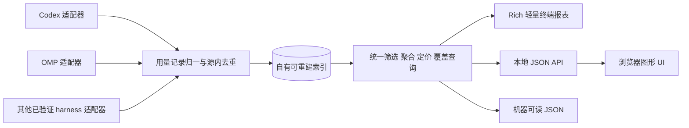

# 跨 harness LLM 用量统计：研究结论与产品方案

更新日期：2026-10-05。本次状态：页面逻辑复核修复已实现，时间、自动刷新、费用比较、明细下钻与分页的浏览器验证通过。用户已认可草案总体布局并授权实施；视觉满意度继续由用户判断。下方各轮保留各自的历史证据。

## 2026-10-05 页面逻辑复核

- 只有截止表达式为“现在”时启用自动刷新。固定截止、过去的相对截止及图表历史缩窗停用计时器和刷新控件；保留偏好，返回“现在”时恢复。历史范围可手动刷新以读取迟到记录。两端输入拒绝未来时间，日历上限跟随当前时间。
- 刷新检查来源文件元数据，未变文件跳过；可追加日志从已读位置继续，变化的 DSH 文件以及替换、截断日志重读。索引更新后重新统计所选时间窗。普通查询不触发来源扫描。
- 比较采用相同筛选下紧邻的上一等长时段，显示完整起止时间。`-48h` 到现在对应前期 `-96h` 到 `-48h`。任一时期的估价不完整时显示具体时期及请求数，已知小计差额仍保留其局限。截图对应旧窗口的上期有 28 次无法估价：23 次缺少可确定的缓存写入组成，5 次价格无法匹配；本期估价完整。两期完整费用变化保持未知。
- 明细下钻后更换分组并再次下钻，累计原有身份条件；返回恢复最初汇总。Dashboard 查看请求清除旧的局部下钻。新查询结果不足以覆盖保存页码时，转到最后有效页。等待查询期间明确提示下方暂留上次结果。
- 浏览器运行 `01a10be8-fbea-71a5-83a5-cc382463dd54` 中六个场景通过，包括未来时间拒绝、两端日历上限、实际环比日期、费用缺失原因、嵌套下钻及自动刷新完整周期。两项失败分别来自旧文案断言和构造保存状态时遗漏实际查询范围；修正验收前提后，运行 `01a10beb-f070-7da8-9587-564bd0e9c898` 补跑历史活动、日常分页与历史刷新场景，3/3 通过，耗时 54.4 秒。历史刷新等待独立成场景，保持每项在 90 秒超时内。
- 类型检查、生产构建及 `uv build` 通过；实际工作台显示“上期 28 次无法估价”与上一等长时段的具体日期。继续沿用未验证真实后台标签页可见性变化的边界；未新增或执行单元 / 组件测试。

## 2026-10-05 第四轮实施：职责分离与亮暗主题

本节依据用户最新决定更新上一节草案的页面边界；先前确认的时间、统计口径、源只读及浏览器验收约定继续适用。

- **Dashboard** 展示费用、用量、调用数等聚合指标，消耗、速率、缓存及可靠计时趋势，以及贡献排行和汇总分析。逐条请求、单轮工具记录和关联详情集中到独立的 **用量明细** 入口。两个入口共享时间和全局筛选，页面切换保留上下文。
- **用量明细** 统一支持逐次请求、会话、轮次、模型和 Harness 分组。先按请求时间入选，再聚合；四类 token、费用、可靠响应 TPS / 轮次 TPS 及缺值保持各自定义。会话使用 Harness、项目和可见短 ID 辨认；本轮不新增原生标题采集或读取消息正文。相同文本 ID 在不同 Harness 中保持独立。
- **时间正确性** 修复历史未闭合轮次和工具因结束缺失长期落入最近窗口的问题；入选要求可证实的窗内请求、工具活动或轮次边界。缺失结束仍为未知。旧会话产生新请求时，保留相应窗内活动。
- **高频操作** 使用本机时区，起止时间各自接受表达式、具体时间或日历选择，精确到秒，可混合使用，应用后共享到两个页面。用户已否定独立相对 / 绝对模式切换，输入内容决定其含义。统计间隔提供 5 / 10 / 30 秒、1 / 15 分钟等分段按钮；自动刷新有独立开关和周期选择，手动动作统一叫“刷新”。指标说明弹窗移除，来源健康在独立区域原位折叠。
- **视觉系统** 保留草案的紧凑布局与数据密度，亮色用暖白表面、暗色用深石墨表面。蓝、青绿、琥珀、珊瑚与淡紫用于数据区分和重点，背景、文字、边框、表格、图例、提示层及控件都采用主题色。页头提供亮 / 暗切换并记住选择。
- **实现边界** 复用现有查询、价格与计时规则；明细只在对应入口加载。继续 PC 范围，不增加 mobile、a11y、i18n 专项，不新增或执行单元 / 组件测试，不引入云服务或外部字体请求。

配色设计参考 [Radix 的调色板组合说明](https://www.radix-ui.com/colors/docs/palette-composition/composing-a-palette)：中性底色与数据强调色分开，暗色背景避免过高饱和度；时间与刷新参考 [Grafana 的看板控件说明](https://grafana.com/docs/grafana/latest/visualizations/dashboards/use-dashboards/)。本项目按个人本机使用场景独立实现，常规使用无需访问这些网站。

### 本轮验收

- [x] Dashboard 与用量明细职责清楚，切换保持时间、筛选和操作上下文。
- [x] 亮暗主题覆盖完整页面、图表和详情，偏好持久化；1600 / 1024 像素界面可用。
- [x] 相对 / 固定时间、截至现在、直接统计间隔和自动刷新控件可用。
- [x] 历史未闭合活动正确排除，旧会话的新活动保留，汇总维度之间四分量一致。
- [x] 用量明细支持可靠身份、完整结果排序分页与下钻，缺计时不伪造 TPS。
- [x] 可复用浏览器验收、静态检查、构建和本机真实缓存集成完成。

### 本机集成证据

- 真实窗口固定为 2026-10-05 16:36:33–17:36:33（Asia/Singapore）。启动刷新后的快照 9111 包含 609 次请求、10 个会话、22 个请求轮次分组；原快照 9101 的 599 次请求保留为历史诊断依据。页面会话汇总与当前索引的输入未缓存 2,411,393、缓存命中 79,128,064、输出 328,693、缓存写入 0 逐项一致，总 Tokens 为 81,868,150。
- 同一窗口的 Dashboard 有 24 个活动轮次，额外轮次有起止或工具活动证据。明细的轮次分组来自窗内请求，两者统计对象有明确区分；历史未闭合状态本身不构成当前活动证据。
- 真实会话存在同 Harness、同项目且前 8 位 ID 相同的情况。项目改为简称，短 ID 独立显示前后两段，完整路径与 ID 保留详情。长路径不再遮住会话标识。
- 视觉检查发现图表容器宽度约束将 SVG 压成 0；删除多余约束后沿用 Recharts 原生尺寸。单个可靠速度样本显示独立数据点，空桶继续保留缺值。实际亮暗页面已确认图表可见。
- `uv build` 已生成 wheel 与 sdist；wheel 包含新版页面资源与 `usage_query.py`，sdist 包含对应源码。个人缓存、浏览器报告和 node_modules 未进入包。最终包内容包含本轮实现与浏览器验收源码。

- `tester-army/e2e` 最终 6/6 通过，耗时 94.33 秒，运行标识 `01a10baf-bb6d-7d37-82c6-c30d54ae05a1`。覆盖独立明细五种分组守恒、历史活动入选、联合身份、全结果排序、重载恢复、刷新去重及时间联动；亮暗 1600 / 1024 页面无横向溢出，柱、线、区域及稀疏计时点实际可见。复跑说明见 `tests/e2e/README.md`，本机报告与 11 张截图在 `.e2e/evidence/`。
- 前端类型检查和生产构建、后端修改文件的 Ruff / Mypy 均通过；未新增或执行单元 / 组件测试。浏览器环境未能真实模拟后台标签页可见性变化，后台暂停行为继续保留这一验证限制。
- 绝对时间入口补充验收：日期时间控件、秒级范围、无效起止、页面联动、重载及固定范围刷新、亮暗 1600 / 1024 布局和返回相对时间通过，运行 `01a10bca-4cfe-7e58-8160-d67633bf9e40`（1/1，3.54 秒）。既有刷新去重 / 图表范围恢复和相对时间 / 自动刷新场景在运行 `01a10bc8-6d42-7884-8fdd-6bbd85dfce32` 中通过；补充场景放在会追加合成数据的刷新场景之前，保持原始手工账本前提。类型检查、生产构建与 `uv build` 通过。
- 用户进一步复核后，统一输入替代模式切换。最新场景覆盖起止两端表达式、两种混合方向、两端日历选择、无效范围、页面联动与重载、固定范围刷新及亮暗 1600 / 1024 布局，运行 `01a10bd3-b249-7947-b8e4-cd1fca2beb87`（1/1，5.41 秒）通过。实际工作台也确认表达式输入旁的日历可直接打开；类型检查及生产构建通过。

## 2026-10-05 用户复核：时间正确性与统一用量明细

本节记录用户新要求、已证实问题和重排建议。下方各轮是历史实现与测试记录。本轮先完成只读诊断和交互草案，应用实现尚未更新。

### 已证实的问题

- 在本机快照 9101、2026-10-05 16:36:33–17:36:33（Asia/Singapore）窗口，实际有 599 次请求、10 个会话、21 个轮次 ID；轮次接口却返回 309 个轮次。287 个轮次没有窗内请求或工具活动，因结束时间缺失被当成无限延续；最老轮次来自 6 月。24 个历史未闭合工具也被错误选入。缺结束记录无法证明当前仍在执行。
- 轮次列表只显时间、项目和 Harness，会话 ID 藏在悬浮提示和详情，无法辨认同项目的多个会话。四源都有联合身份 `(harness, session_id)`；当前索引与 API 尚无会话标题。
- 汇总表与轮次表是两个入口，没有一个统一的“如何汇总”选择；全局逐次请求分页接口尚缺。现有后端已保留四类 token 分量，页面只放总 Tokens，妨碍判断缓存与输出开销。
- 时间输入被藏进大模态框，统计间隔和自动刷新依赖下拉框；时区占用个人本机页面的高频操作位置。指标说明、数据来源折叠和刷新动作并排放置，混淆了不同作用。
- “扫描数据”“服务档位”“default”“unknown”等内部命名增加理解成本。Codex 的 `default/standard` 可解释为标准模式，`priority/fast` 为 Fast，`unknown` 表示源没有记录；后者不能解释为 Fast 已关闭。

### 用户明确的使用要求

- 一张用量明细表，支持按会话、轮次、模型、Harness 汇总；选择不汇总时，每行是一条请求。
- 至少显式展示输入、缓存命中、输出、缓存写入和 TPS。输入列采用“输入（未缓存）”，四分量能够解释总量，避免将包含缓存的总输入与缓存重复相加。
- 时间范围直接在页面编辑，保留相对表达式和截至现在；本机时区自动采用系统设置。
- 统计间隔直接切换 5 秒、10 秒、30 秒、1 分钟、15 分钟等常用值；自动刷新具有明确开关，手动动作叫“刷新”。
- 移除指标说明弹窗。列名、单位和就地状态表达必要含义；数据来源在自己的区域原位折叠。

### 重排建议与数据约束

1. 页面从上到下组织为：时间与刷新 → 对象筛选 → 主要数字 → 趋势 → 统一用量表 → 数据来源折叠区。常用操作在当前页面完成。
2. 时间条直接显示“从 [-1h] 至 [现在]”，可输入绝对时间；快捷时段一按生效。图表间隔使用一组分段按钮；自动刷新使用开关与相邻周期按钮。过细粒度超出当前窗口允许的点数时，提供适合当前窗口的选项。
3. 用量表顶部固定提供“逐次请求 / 按会话 / 按轮次 / 按模型 / 按 Harness”。同一时间窗内的请求先入选，再聚合；汇总、趋势与明细共用这个集合。时间列显示窗内请求时间；旧会话在当前窗口产生请求时可以出现，纯历史空活动轮次不入选。
4. 会话标识始终可见：原生标题可用时优先展示，辅以项目、Harness、短 ID；没有标题时显示项目和短 ID。子代理保留可区分的后缀与父子关系。标题从来源自有元数据读取，现有代码尚未接入；原始消息正文不参与命名。
5. 点击汇总行下钻到对应请求，保留可移除的对象筛选。展开请求或轮次时就地显示关联信息。排序作用于完整匹配结果后再分页。
6. 请求级 TPS 仅使用与该事件对应的响应计时；轮次 TPS 使用真实轮次耗时。两种速度在需要时明确分列，缺失计时留空，禁止把轮次速度分摊成逐请求速度或用整段时间平均吞吐替代。不同定义继续保持各自口径。
7. Fast 用可理解的模式值呈现；源未记录时显示“未记录”，不直接暴露原始 `unknown`。非 Codex 的模式沿用该来源已证实的含义。

### 本轮交付与后续验收边界

- 只读诊断已完成；本机可点击草案为 `.scratch/ui-review-v4/index.html`，使用明确标识的示例数据，用于试时间、汇总切换与逐次请求下钻。
- 应用中的时间错误、统一请求表和新控件尚未实施。本次不将交互草案或历史测试结果当成修复完成。
- 后续浏览器验收须加入“历史未闭合轮次和工具不污染最近窗口”“旧会话有新请求时保留”“相同窗内请求在全部汇总维度下四分量一致”“同项目多个会话可区分”及常用控件的一步操作。继续遵守本会话不新增单元/组件测试的约定。

## 2026-10-05 第三轮：面向日常使用的 Dashboard

用户已接受 UI review 的调整方向，并授权持续推进至交付。现有统计口径、四源范围、单机只读、PC 及浏览器验收约定继续适用。

- 压缩页头、装饰与常驻导航，把费用、Tokens、模型调用和轮次放在首屏；主消耗趋势与来源/模型/项目排行相邻，效率面板按主次组织。
- 同页保留请求速率、缓存、执行速度及轮次工具分析，共用唯一全局时间与筛选；面板提供稳定默认视图，低频配置按需打开，柱线区域及时间缩放能力继续可用。
- 汇总和轮次明细切换展示。轮次优先呈现时间、项目与来源；内部 ID 放在详情。费用、耗时等排序作用于全部匹配结果后再分页。
- 已记录工具数量与轮次小计均值作为有用统计展示，并标记部分覆盖。原有完整值语义保留，完全缺价或无样本仍显示未知；不改变已确认的计量与价格规则。
- 保存全局范围模式、筛选及面板偏好，重载恢复分析上下文。局部配置和轮次翻页只查询受影响数据；全局更新保留布局、明确更新状态并继续保证结果一致性。
- 时间选择支持 `-18h`、`-2days` 等相对表达式、固定起点截至现在，以及固定历史起止。滚动范围在刷新时重新计算当前边界；固定历史保持原值。提供默认关闭、可选间隔的自动刷新，增量扫描完成后更新数据；后台和编辑时间时暂停，避免刷新重叠。范围模式与刷新设置均保存。
- 源读取状态与详细定义按需打开。界面以数据与操作为中心；不重新添加教学流程、重复免责声明或实现术语。
- 轮次列表的状态列只显示完成、进行中等状态；边界来源、整轮小计和窗口截断等解释留在详情，避免逐行重复小字干扰阅读。
- 继续采用已确认的子代理纪律：一次性交代责任、背景、边界、验收和汇报条件，主会话推进独立工作，完成后整合；本轮不新增单元或组件测试。

### 本轮验收

- [x] 首屏核心指标、主趋势和排行主次清楚，PC 常见宽度下名称、数字与单位可读。
- [x] 图表能力和全局联动保留；常驻控件收敛，汇总与轮次详情可连贯切换。
- [x] 部分数据的主数字与状态准确，轮次费用/耗时排序覆盖完整结果。
- [x] 重载恢复筛选和视图；相对范围刷新、自定义历史、缩放返回语义稳定。
- [x] 相对表达式、固定起点截至现在与自动刷新可用，刷新推进当前时间，固定历史保持不变。
- [x] 局部操作不重查无关面板，更新与失败状态不误导当前分析范围。
- [x] 可复用浏览器场景、生产构建与包内容验证通过，真实数据页完成相称的集成检查。

### 性能依据

真实统计缓存的浏览器测量显示，五个分析查询与轮次查询并发读取时，首屏约需 19.4 秒。相同缓存、相同页面将查询串行后约需 5.4 秒；单个分析查询本身约 0.9 秒。主要耗时来自并发 SQLite 行转换与 Python 数据处理竞争。服务层增加独立查询锁，扫描与状态读取继续独立；前端同时减少无关重查。最终页面在相同缓存上的首屏为 4.9 秒，全部接口返回 200，状态请求从重复六次收敛为一次。该数值是本机这份缓存的观测结果。

### 本轮集成证据

- 统一 `tester-army/e2e` 浏览器运行 6/6 通过，耗时 72.45 秒。覆盖原有数值与连续分析路径，以及保存上下文、局部请求、25 轮全结果排序、部分覆盖手算均值、新时间控件和真实 15 秒自动刷新。1600 / 1024 像素截图已生成，1024 页面无横向溢出。复跑：`npm --prefix web run test:e2e`，说明见 `tests/e2e/README.md`；本机统一报告为 `.e2e/report.json`。
- 后端改动的 ruff、mypy 通过，前端类型检查与生产构建通过。本轮未新增或执行单元、组件测试。
- 新版真实数据页面已检查首屏指标、主趋势与排行、辅助面板和汇总列表；本机服务已重启使用新版。最近一次增量扫描读取 2760 个文件，2754 个未改变，失败为 0。
- `uv build` 成功，wheel 包含新版静态页面与轮次查询模块，sdist 包含时间控件源码与浏览器场景；个人缓存、测试报告及 node_modules 均未进入包。
- 自动刷新后台暂停已实现。当前浏览器验收接口无法真实切换后台标签页；IAB 的隐藏操作也保持 `document.hidden=false`，因此这项行为未计为浏览器验证通过。

## 2026-10-05 第二轮：统一时间的分析 Dashboard

用户已明确授权推进本轮需求实现。先调整数据层与页面，再执行浏览器验收。以下内容更新第一轮的交互与测试约定；个人本机、源只读、PC、估值与未知覆盖等既有边界继续适用。

### 页面与时间

- 同一页面只有一个全局时间范围、时区和时间切片控制区。全部指标、图表、轮次与会话明细使用该上下文；局部图表不另设独立时间范围。
- 时间范围决定观察哪一段历史，时间切片决定每个数据点覆盖多久。支持自动与分钟级、小时级、天级切片；自动粒度随范围收敛，避免生成不可读的过量数据点。
- 点击或框选趋势范围更新全页时间，并提供返回上一范围的操作。首尾不完整切片使用实际覆盖时长作为速率分母。
- 工具、模型、项目、用途等全局筛选共同决定分析对象。图表分组、指标与图形选择决定局部观察角度，作用范围在界面上明确。
- 页面同时展示消耗、请求强度、缓存效率、执行速度、轮次开销与工具使用。主要面板并列形成总览，末尾提供可追溯的明细。
- 折线图、区域图与柱状图均使用同一时间切片，并支持提示、成员比较与时间联动。加性分量可以堆叠；比率、均值和不同定义的速度保持各自口径。

### 用户使用路径与设计验收

用户补充要求：从使用者角度检查整个设计，不能把改进收窄为替换“切片”等词语。页面按以下连续路径组织，保留自由筛选和查看各面板的能力。

1. 打开页面，辨认当前时间范围，读懂费用、用量及数据缺口。
2. 查看趋势，找到需要解释的时段；点击或选择该时段后，全页使用同一范围，能返回上一个范围。
3. 比较模型、工具来源或项目的贡献；分清“改变全页分析对象”与“改变当前图表的分组或指标”。
4. 查看相应轮次和工具调用，用记录中的用量、状态与耗时解释消耗；关闭详情后保留当前分析上下文。

页面提供清楚的概览、趋势、轮次和明细入口，控件标明用途，默认展示能帮助判断的内容。长工具列表和低频口径说明采用渐进披露；缺失数据在相关数字旁说明。快照一致性、原子更新等实现细节保留在技术文档，用户界面采用可理解的状态表达。浏览器验收包含一条贯穿上述步骤的使用路径。

用户复核后的呈现约束：主界面以数字、图表和筛选为主；移除各图重复的口径、未知值说明和教学式段落。详细定义集中到右上角“指标说明”弹窗，仅在点击后展示；缺价和数据缺失用对应数字旁的简短状态表达。用户路径用于设计与验收，不在界面上铺陈成教程。

### 指标与统计对象

| 方面 | 本轮交付内容 | 口径 |
|---|---|---|
| 消耗 | 输入、输出、缓存读写、总 tokens、估算费用趋势 | 沿用事件发生时间与缺价覆盖 |
| 请求强度 | TPM、RPM、每秒平均 token 吞吐、RPS | 按已记录用量或调用数除以实际窗口时长；标明记录时间依据，不声称恢复了供应商限额或瞬时 token 流 |
| 缓存效率 | 缓存命中率及命中、未命中、写入量趋势 | 合计分子/分母，不平均单次百分比；缺分量显示未知覆盖 |
| 执行速度 | 有可靠计时的输出速度、轮次耗时与 P50/P95 | 区分模型响应与轮次端到端计时；后者包含工具与等待，不跨定义混排 |
| 对话轮次 | 轮次数量与状态、每轮模型调用数、tokens、费用、耗时 | 会话、轮次与模型调用分别计数；完整轮次与窗口截断轮次有明确标识 |
| 工具使用 | 工具调用次数、每轮次数、工具名称/状态分布及可靠耗时 | 按调用身份去重，保留未知结果，工具记录缺失不能伪装为零 |

数据关联为会话 → 轮次 → 模型调用/工具调用。轮次可以包含多模型和多次工具执行；失败、中断及多模型轮次也需要保留统计身份。父子代理归属依赖真实标识；缺乏关联依据时保持未知，不把相邻时间当作因果证据。

全局窗口内的消耗继续按事件时间统计。轮次视图说明窗口内小计与完整轮次开销的区别；完整落窗且已结束的轮次可以计算每轮已记录用量、开销与耗时，并分别说明原生边界和推导边界的参与数量。推导边界保留可用统计及其质量标识；缺价仍影响完整费用，源日志缺失记录不被包装为完整账单。详情可以追溯该轮已记录调用，明确整轮与窗口范围。源记录没有保存的工具参数、输出正文、prompt 或凭据不进入索引和 API。

### 验证方式与责任边界

用户已指定本轮不新增或扩展单元测试、组件测试。需要功能验证时，使用 `tester-army/e2e` 的本地浏览器自动化，并将通过的脚本、脱敏源夹具、前置条件与运行命令纳入仓库。构建、类型与静态检查继续用于确认交付可运行。

浏览器用例使用真实应用服务与隔离的四源输入、缓存和价格配置。关键数值通过可手算样例在页面断言；不使用业务查询函数的返回值作为预期答案。固定测试依赖版本，关闭 e2e 遥测；默认无模型模式，不向外部模型发送真实日志或页面数据。现有历史测试保留，本轮不以其通过代替新增需求验收。

委派采用已有 Sol 6.1 子代理：一次性交代目标、背景、边界、验收与汇报条件；中途仅报告阻塞、范围变化或决策需求。主会话推进独立工作，收到完成报告后做必要整合，不例行轮询、不微观指导、不重复已完成的验证。

### 本轮验收清单

- [x] 同页唯一全局时间控制；范围、时区、时间切片与全局筛选同步作用于所有面板和明细。
- [x] 多面板 Dashboard 同时呈现主要分析角度；柱、线、区域图均支持时间切片与缩窗返回。
- [x] 用户能从概览定位时段和对象，再进入轮次解释用量，关闭详情与返回范围后保留可理解的分析上下文。
- [x] TPM/RPM/每秒平均吞吐/RPS 使用实际切片时长，部分桶、空桶与未知覆盖可以解释。
- [x] 缓存效率与有可靠计时的输出速度、轮次耗时趋势具有清楚且一致的定义。
- [x] 四源轮次与工具记录按实际格式接入；缺边界、继承、重复、未完成状态和覆盖缺口如实表达。
- [x] 可查看单轮 tokens、模型调用、工具调用、估算开销、状态与耗时，并下钻到统计元数据。
- [x] 刷新后的追加记录、轮次完成和工具结果更新可见，重复刷新不重复计数；已有索引自动升级。
- [x] 新功能完成后通过可复用的本地浏览器 test cases；安装包包含新页面和数据实现，使用说明与限制同步更新。

### 本轮实施证据

- SQLite 索引升级为轮次、工具调用与用量事件关联；四源适配保留原生或推导边界、未完成状态和未知覆盖。
- 真实来源验收发现 Codex 原生 `started_at` / `completed_at` 为 Unix 秒，通用数值时间转换曾按毫秒处理。专用转换与 Codex 适配器版本升级已修复，重建后浏览器恢复当前日期的轮次与工具关联。
- 集成后的 ruff 和 mypy 通过（24 个源文件），前端类型检查与生产构建通过；本轮未新增或执行单元、组件测试。

- 隔离真实服务上的 `tester-army/e2e` 浏览器验收 4/4 通过，耗时 14.99 秒：连续分析路径、手算部分时段速率/缓存/计时/均值、轮次工具详情、追加与重复去重、缺值空态、相对范围刷新与历史范围返回。复跑命令为 `npm --prefix web run test:e2e`；用例、四源合成日志与手算依据见 `tests/e2e/README.md`。本机报告在 `.e2e/`，运行标识为 `01a10b08-e11f-7763-9de5-f9d51c1a2e58`。
- 真实数据页面已核对概览、常驻页内导航、来源贡献与轮次的阅读衔接；工具排行默认六项展开，关闭详情保留上下文。预设近 24 小时/7 天/30 天在扫描后更新至当下，自定义与缩放范围保持固定。
- `uv build` 生成 wheel 与 sdist；内容核对确认新版静态资源、轮次模块和浏览器配置随包交付，个人缓存、测试报告及 node_modules 未进入安装包。缺价、缺失 usage 和推导轮次边界仍按既有口径保留，真实账单未知。

## 2026-10-05 第一轮实施基线与交付记录

本节是当前执行依据。下方 2026-09-27 研究中的“只授权研究”“来源尚未确认”“采用路线待决定”“双入口同等建设”“实施前再审批”等条款，适用当时任务；本次按本节已确认范围直接推进。关联研究文档保留其历史证据价值，发生冲突时采用本节。本次就地复用本文件，不另建规格流程或增加审批门槛。

### 用户已确认的范围

| 项 | 本次确认 |
|---|---|
| 工作目标 | 升级重构现有 `codex-usage` 项目，做深用量分析 |
| 首批来源 | Codex、Claude、OMP（oh my pi）、DSH（deepseek harness）四种 harness |
| 部署与使用 | 首版本机个人用量；沿用单机本地、source 只读的边界 |
| 产品入口 | 新 UI 只做 PC 网页版；保留现有 CLI 的有价值功能；本次不扩展桌面安装包或 TUI，也不要求重做整套终端体验 |
| 分析能力 | 各统计维度都能查看时间趋势，维度比较、筛选和时间线是本次核心 |
| 参考重点 | 借鉴 CodeBurn、New API 用量工作台的统计维度、筛选方式和时间线；网页视觉重新设计，用户未认可两者的 UI 审美作为目标 |
| 视觉要求 | 有品位、易读，清楚显示数字、单位、筛选范围和信息层级；需实际浏览器验证 |
| 本次排除 | mobile 专项、accessibility、internationalization；多机汇总、团队权限、桌面安装包与全屏终端应用 |
| 执行协作 | Astra 调度，Sol 6.1 承担大部分实施工作；责任划分与集成由主会话负责 |

包名与命令暂沿用 `codex-usage`；网页标题可使用“用量工作台”。这是当前实施选择，用户尚未为产品定名，不额外建立命令别名或迁移工程。

### 分析与数据口径

四个来源接入同一计量与查询层。适配器按实际源记录确认能力，界面显示读到的范围、未提供的字段与解析失败；来源没有记录、路径不可用、格式不支持和解析失败分别表达。每种 harness 都要有真实格式证据和脱敏夹具，支持名单不能替代读取与计量验证。

底层保留用量事件的发生时间，时间筛选、跨日分桶和趋势按事件时间执行。来源只提供会话汇总时保留其汇总粒度与时间局限；不得把全部历史用量强行放在会话首日。重复快照、父历史继承、辅助调用、归档与活跃记录按各来源语义处理，重扫不倍增。

统计字段限于时间、用量、来源身份、模型、provider、项目、会话关系、用途、档位、价格依据和可用的计时信息等必要元数据。API、统计索引与导出不含会话正文、prompt、工具参数或凭据；本工具只写自有可重建缓存，不修改源日志、harness 配置或外部统计库。

分析维度以实际可读元数据为基础：harness、provider、model、project、session / family、agent kind、purpose、service tier。每个已支持维度可组合筛选、切换分组、查看所选项的时间趋势，并与总览使用同一时间范围。来源缺字段时保留“未知”分组与覆盖说明，不推断项目归属、代理角色或父子关系。家族视图区分会话自身与包含子代理的总量，避免重复累加。

金额区分来源估值、价目估值和实际账单；缺价、部分计价和完全未知有明确状态。当前真实账单未知，页面不声称估算金额等于实际扣费。已知估算小计单独展示，并说明未计价覆盖；缺价记录保留 tokens 与调用信息，金额使用未知值。前端展示后端提供的统一数值与费用状态，不另算一套金额。Codex 已有服务档位计价与计量审计能力应保留。

现有 CLI 中的会话 / 子代理 / 家族、模型与时间筛选、原始粒度、JSON、自描述 `--schema`、诊断 `--doctor`、计量依据和 TPS 等有价值能力继续可用。已有图表能力的保留或收敛按集成结果明确记录，不以本次网页建设默认授权删除旧命令。TPS 继续表达有匹配起止信息的完整单模型 turn 的端到端输出速度；没有计时信息的来源不补假值。

### 本次分析交互的实施选择

主会话已向用户说明本次收敛方向：帮助个人回答“用量为何变化、花在哪里、效率怎样变化”。以下是据此采用的首版设计，已有的实施与验收证据见下方状态记录。

- 当前时间窗对比上一等长时间窗，使用相同筛选口径；总览展示变化，维度明细展示当前成员相对上一窗的增量贡献。前一窗没有有效基数时明确状态，百分比不填假值。
- 展示每调用成本、每百万 tokens 成本、缓存命中率的时间趋势。成本指标保留费用完整性与其分母范围；缓存指标按各来源实际定义表达，无法比较的分量不混合成一个看似统一的比率。
- 维度趋势支持绝对量与占比切换，占比说明分母与未知覆盖；费用占比只覆盖有效已知金额，未知费用不表达为免费。
- 趋势峰值可以选择更小时间窗，并联动账本下钻，查看对应来源、模型、项目或会话明细。
- 以趋势、比较与账本承载分析，不堆饼图。来源没有产出质量证据，不推断模型性价比；不同定义的 TPS 不混入同一速度排行。

### 网页交付与实施建议

网页至少包含当前范围总览、时间趋势、可切换维度的明细、选中项下钻与来源覆盖状态。用户能够从模型、项目或来源进入分析，也能够调整时间范围后继续查看当前选择；无需遵循固定下钻顺序。筛选、总览、趋势和明细相互一致，空态、缺价与单源失败仍可解释。

视觉以清楚的数值与节奏为中心：稳定的列对齐、可辨识的长模型名、克制的强调色、清晰的趋势刻度与图例；避免大量装饰卡片挤占分析空间。用户最新确认本次只做 PC；保留已有基本响应式布局，停止 mobile 专项建设与验收。PC 常见窗口中的名称、数字与单位可读性保留为质量要求，本次不追加 WCAG、ARIA/treegrid、纯键盘验收或多语言平台等专项门禁。

本次已冻结实现架构：Python 查询核心、SQLite 自有统计索引、Starlette/Uvicorn 本地服务、React/TypeScript/Recharts 网页，静态资源随 Python 包发行。入口为 `codex-usage --web`；用户运行时无需 Node。网页多源分析共用新查询层，现有 Codex CLI 报表继续保留，尚未迁移为四源输出契约。技术选型是实施团队依据任务收敛的选择。

HTTP 边界已确定为 loopback 监听、Host/Origin 精确同源校验、Fetch Metadata 检查、无 CORS、POST JSON。服务不使用启动 token 或认证 cookie，同机任意进程及账户可读取统计，源文件权限不提供该 HTTP 入口的账户隔离。本次沿用个人工作站使用边界。普通查询离线，资源随包交付；价格联网更新需显式操作。查询不隐式触发全量扫描，刷新只写自有缓存，单源失败有可观察状态。进程随显式前台启动与退出运行，退出释放监听端口；浏览器标签页关闭的行为不承担进程清理保证。不增加后台 daemon 或常驻多机服务。

### 本次验收清单

以下验收项已取得相应证据，具体测试、实测范围与已知限制见下方实施状态记录。

- [x] 四个 harness 各有实际来源格式核对、脱敏夹具和可复算样例；辅助用量与未知字段的支持范围有说明。
- [x] 时间筛选按事件时间生效，跨夜会话正确落入日期桶；模型切换、重复 / 继承快照、重扫和来源特有缓存分量有针对性验证。
- [x] 每个实际支持的统计维度可组合筛选并查看时间趋势；选中维度项、切换分组和调整时间范围后，总览、趋势与明细口径一致。
- [x] 当前窗与上一等长窗比较可复算；总览变化和当前维度成员增量贡献使用相同筛选与计量口径，无有效基数时状态明确。
- [x] 每调用成本、每百万 tokens 成本和缓存命中率趋势显示定义、分母范围与缺失状态；绝对量 / 占比切换及峰值缩窗下钻可操作，不推断产出质量或混排不同 TPS 定义。
- [x] 项目身份、会话自身 / 家族边界与用途来源可追溯；未知字段不伪造，不对会话正文做归因。Codex resume 原生事件 parent / agent 归属修复已通过回归。
- [x] 金额显示性质、已知小计与缺价覆盖；实际账单未知、缺价金额、缺失 TPS 均不填零冒充有效数据，Codex 档位计价保留。
- [x] 连续不同筛选无状态污染，重复查询结果稳定；来源不可用、无记录、解析失败和查询无结果分别可见。
- [x] 网页在真实浏览器完成时间筛选、维度筛选、趋势查看、明细下钻、清除筛选与刷新；1440px、1024px PC 视口中名称、数字与单位可读，无整页横向溢出。
- [x] 网页视觉重新设计，CodeBurn / New API 的参考明确落在统计维度、筛选与时间线；UI 实测结果随交付记录，公共文档使用匿名统计，不包含真实项目名、路径或截图。
- [x] 现有有价值 CLI 能力与 JSON / schema / doctor 契约按受影响范围回归；网页与 CLI 对同一可比范围得到一致用量与费用状态。
- [x] API、统计缓存与导出不含会话正文和凭据，源文件保持只读；本地服务启动 / 退出、离线资源和显式价格更新行为可验证。
- [x] 安装包包含可运行的网页资源，交付说明写明启动方式、四源支持范围、分析口径与已知限制；测试和实际浏览器验收记录完成后再标记交付完成。

历史研究中的 P95 ≤200ms、320px 全功能、索引取消、一次性认证 token 等内容仍属于方案建议，实施按当前实际数据量、风险和收益确定。它们不自动成为本次新增硬性需求；保持筛选交互可用、避免每次重扫全量源日志，以及本机服务与隐私边界。

### 实施状态记录

截至 2026-10-05，四源适配、SQLite 索引、共享查询、本地服务、PC 网页和使用文档已完成本次实施验收，验收清单全部勾选。证据如下。

- 最终后端 324 tests passed，68 warnings，过时的 xfail 已转为正常门禁；ruff、mypy（22 files）与 diff check 通过。前端 7 tests、typecheck 与静态 build 通过。
- wheel / sdist 包含 HTML、JS、CSS、定价与四源模块；隔离安装后的 CLI `--analytics` 与 HTTP 对同一合成范围均得到 120 tokens，详情不含正文，静态资源可访问。
- 一次真实来源只读验收扫描快照完成 2756 个权威文件、203785 个唯一事件，无文件读取错误。三源明细为 Claude 144、OMP 700、DSH 139 个文件；DSH 115 条 coverage warnings 明确显示 partial，包括 13 个 attempt 及 title/search 日志没有持久 usage。已记录用量保留，缺失辅助调用 tokens 无法恢复。
- 八个维度在同一 7 天窗口满足 summary = breakdown 合计 = buckets 合计，分成员 series 保持加性指标守恒。代表性查询耗时 0.763–0.800 秒，优化前为 9.1–9.5 秒；这是本机实测范围，历史 P95 ≤200ms 建议未作为当前门槛。
- PC 真实浏览器通过工具筛选、模型分组、Tokens / 占比切换、成员折线、相关会话详情、峰值缩为 hour 和 coverage 查看；无 pageerror 或外网请求，1440px / 1024px 无整页横向溢出。保留基本 responsive，mobile 专项已按用户最新范围停止。
- DSH 压缩由 base Python `zstandard` 读取；Claude 本地全零 `<synthetic>` 消息过滤、缓存写 TTL 子集计价与来源总量单列已纳入共享查询。真实账单未知，未结算 / 未计价覆盖仍明确保留。

Codex resume 归属修复已完成：CodexAdapter v2 保留逻辑 thread ID，恢复 55 个 resume 文件中 2487 条原生事件的 parent、agent_label 与 `purpose=subagent`；其中 2329 条恢复 agent_type，另外 158 条的原 spawn 记录没有 role，继续保留未知。2487 条事件的 project、tokens、session、model、tier、provider 均不变，专项 92 tests passed。适配器版本升级触发相应 Codex 索引重建，源文件保持只读；上述扫描数量保留为验收快照。

公共验收记录只使用匿名统计；本文件不新增真实项目名、路径或截图。本次验收完成，既定 PC、个人单机范围与缺失 usage、真实账单未知等已知限制保持明确。

---

## 2026-09-27 历史研究与实测

以下是当时的研究结论、推荐和授权状态，供实现追溯证据使用。本次执行与验收采用上方 2026-10-05 基线。原研究状态：CodeBurn 已从源码实际运行对照；当时产品实现未开始，终端已改为 ccusage 式轻量输出，替代对照排除全部绘图。

## 1. 结论先行

1. **有成熟同类产品，不能把“多 harness + OMP + UI/TUI”当市场空白。** CodeBurn 最接近整套目标，Tokscale 和 agentsview 分别提供强 TUI 与本地 Web 参考；OMP 自己也有官方 `omp stats` 看板。
2. **不再以终端嵌图或全屏应用为主路线。** 终端参考 ccusage：一次性报表、宽度适配、参数筛选、滚动历史与管道；图形交互交给本地浏览器。不引入 Textual。
3. **两端共用的是计量与查询，不是 UI 布局。** 同一快照、筛选和价格基准必须得到相同数字；网页和终端各用合适的呈现与操作方式。
4. **当前仓库不是换皮即可。** 已运行探针确认跨日分桶错误和原地筛选污染；调用时间与辅助用途等需要保留到统一层，才能长期交互、正确追溯。
5. **CodeBurn 已实测，不能无改造完整替代。** 真实日窗口tokens和calls一致，但家族实体、分钟过滤、档位计价、raw和机器契约等有缺口。继续比较扩展CodeBurn与本项目改造，不假设只补一个OMP parser即可。

## 2. 2026-09-27 用户已确认的需求（历史）

| 项 | 已定边界 |
|---|---|
| 统计对象 | 从 Codex 专用扩展为多 harness 的 LLM 用量；OMP 是当前明确缺口，不是最终覆盖上限 |
| 数据范围 | 单机本地 |
| 图形界面 | 本地浏览器，不是桌面安装包 |
| 入口优先级 | Web 与终端同等重要；终端明确采用轻量一次性输出，不要求全屏或交互镜像 |
| 体验约束 | 不依赖终端图片协议；解决信息层级、排版、宽窄屏和交互问题 |
| 本轮授权 | 并行研究、拉取运行CodeBurn并对照全部现有非绘图能力；不实施产品改造 |

继续采用当前项目的本地只读原则：不上传日志、不读凭据、不拦截 API、不修改 harness 配置。自有缓存可重建；价格联网更新必须显式触发。

“所有 harness”是扩展目标，不是假装有通用日志格式。实施批次必须列明来源与支持能力，不能静默缩成两个，也不能宣称任何工具都有可恢复的历史精确用量。

## 3. 调研文档

- [竞品、源码边界与采用/扩展/自建比较](2026-09-27-harness-market.md)
- [Web/TUI 信息架构、技术选型、状态与尺寸验收](2026-09-27-harness-interfaces.md)
- [数据接入、OMP 覆盖、实测缺陷与统一计量](2026-09-27-harness-data.md)
- [CodeBurn 固定版本非绘图能力实测](2026-09-27-codeburn-verification.md)
- [ccusage 式轻量终端与 Rich 探针](2026-09-27-lightweight-terminal.md)

旧 [Codex 专用竞品调研](../competitors.md) 保留为历史记录。其中“终端真图是优势”“把 Codex 做深”的定位不作为本方案结论，旧数量/版本也不作为本轮事实。

## 4. 关键事实如何影响决策

| 已取得证据 | 对方案的影响 | 证据等级 |
|---|---|---|
| CodeBurn 有 TUI、本地网页和独立 OMP parser；Tokscale/agentsview 明列 OMP | 必须比较采用或补差，不从零假设没人覆盖 | 本轮官方文档/源码 |
| CodeBurn当前pi.ts跳过非message；合成model_usage追加后总量不变 | 不能把OMP支持名单当成全部辅助调用覆盖 | 源码与真实CLI合成探针 |
| OMP 官方 stats 上游处理 model_usage；本机 stats 库尚未包含本项目抽样的 72 条辅助记录 | 必须区分源日志、投影、版本、新鲜度，不能只读旧库便声称实时完整 | 上游源码 + 本机只读结构/查询 |
| 两天各 100 tokens 被当前 `group_by_day` 合成首日 200 | 统一记录需保留调用发生时间，日期桶不能用会话首日 | 主代理运行合成探针 |
| 同一缓存先筛 model-a，再筛 model-b，第二次返回空 | 长生命周期查询必须无副作用，不复用可变筛选结果 | 主代理运行合成探针 |
| 研究代理运行现有全历史查询约 5.26 秒 | 交互查询不能每次重扫，推荐自有可重建索引 | 单机样本，不是性能保证 |

已构建CodeBurn固定版本并运行真实日期/合成夹具/80列PTY；未运行新的自建Web/TUI。详细实测和限制见CodeBurn报告，不能将部分样例通过扩大成全部能力等价。

## 5. 产品推荐形态

### 5.1 本地浏览器：账本为主，图表辅助

首屏：时间与来源筛选、用量/已知估算费用/缺价提示、紧凑趋势、可切换维度账本、选中项详情。模型、harness、项目、用途都可横切；会话详情里才呈现子代理树与家族时间线。

三个研究方向的取舍：

- **账本 + 趋势：推荐。** 高频问题是“哪里用了多少、是否可信”，响应式与数值对齐容易控制。
- **时间线优先：不作首页。** 上千会话不可读，保留为单家族详情。
- **追溯树优先：不作首页。** 跨模型分析不自然，保留为会话下钻。

风格建议：克制的分析工作台，少装饰、数字清楚、颜色服务语义。尚未做高保真视觉定稿，不能用框架名承诺审美。

### 5.2 终端：轻量报表，不做全屏应用

默认打印一次并退出，保留历史；输出前探测宽度，宽屏显示更多列，窄屏减少次要列或转纵向字段。核心名称与数字可读，完整指标通过详情参数或JSON获取，不默认接管键盘或启动分页器。

每次调用适配当前宽度，不承诺进程退出后动态重排历史。NO_COLOR关闭颜色不保证零ANSI，严格纯文本另行控制；管道和JSON无UI控制序列。watch不是当前默认需求。

Web与终端共享筛选、数值和覆盖语义，但网页联动操作与终端参数不需要一一镜像。轻量终端不是Web启动器，也不是缩水为只有总额。

## 6. 如果选择继续改造本项目

### 推荐技术组合

- Python 保留可验证的 Codex 计量知识，拆开源特定算法与通用记录。
- SQLite 作为共享索引，源文件只读；同步与查询分离，查询结果带快照标识。
- 终端保留 Rich，重做列预算与紧凑布局；撤回 Textual/全屏状态机，不为美观切 Rust/Go。
- Web 选 TypeScript/React 构建成静态资源随包发行；运行时无 Node/CDN 依赖。
- HTTP 选小型 ASGI 应用，避免自行扩展 `http.server` 成安全框架。
- 图表初始采用一个成熟浏览器图表库，列表服务端分页；性能验证后再引虚拟化。

具体 ASGI/图表版本是实施级选择，需要依赖与探针确认，不冒充已经冻结的施工计划。当前推荐足够判断架构与维护边界，不意味着自动授权换整个技术栈。

### 数据决定

- 以用量事件而非会话汇总为底层；source 粒度只有汇总时明确标注。
- harness、provider、model 分离；保留原始身份和用途。
- 缓存读/写、推理/其他分量按来源语义处理；不套统一错误加法。
- 金额性质和完整性分开，未知不是零；前端只格式化，不重算。
- OMP 推荐提取原始 usage 记录，而非依赖可能过期的外部 stats 库；官方库用于对账或经验证的可选输入，不能双算。
- 调用、会话、家族三种总量边界清楚；来源不支持父子归属时显示未知，不造树。

### 退出与恢复

索引失败保留旧快照并标过期；格式变化按来源重建；追加半行不入账；重扫不能翻倍。Web前台进程显式退出，终端命令输出后退出且不改终端模式。后台daemon、多机锁服务和通用事件总线不在设计范围。

## 7. 2026-09-27 实施前的决策门（已由本次授权与基线更新）

这不是现在开始写代码的任务清单，而是把研究转为可实施方案的顺序：

1. **现成产品验收门已取得结果**：CodeBurn真实窗口总tokens/calls一致，但非绘图能力不完整；见实测矩阵。不能直接切换，也不因某一个缺口就决定重写。
2. **确定采用路线**：若有限补丁即可满足，优先采用/贡献/维护小 fork；若两端交互和计量模型都不合适，再选择本项目改造。不把某一个 parser 缺口当全盘重写理由。
3. **冻结首批来源清单**：Codex、OMP 已明确；其他实际使用的 harness 需逐一列名和能力。此清单尚未由用户确认，不擅自缩小“所有 harness”的目标。
4. **视觉与输出定稿**：若自建，产出Web真实布局样稿及轻量终端宽/中/窄输出样例，使用同一脱敏数据。终端不建设全屏原型。
5. **制定可执行改造计划**：冻结查询契约、计量语义、数据来源、命令切换、缓存与恢复；将工作拆成可验证的责任单元。

### 自建情况下的责任单元草案

| 单元 | 内容 | 验收/恢复 |
|---|---|---|
| 用量契约与数据核心 | Codex 迁移、OMP 接入、覆盖能力、去重、日期桶、费用性质 | 合成边界与真实脱敏窗口复算；源数据不写；自有索引可删重建 |
| 共享查询与索引 | 纯查询、快照、分页、索引刷新 | 相同查询幂等、重扫不倍增、单源失败明确；旧快照可读 |
| Web | 账本、趋势、详情、覆盖、响应式与本地安全 | 真实浏览器三档尺寸及完整操作，无外网请求 |
| 轻量终端 | 响应式报表、参数筛选、详情、JSON、纯文本管道 | 真实PTY与120/80/60/40列、CJK、无色、不清屏、输出后退出 |
| 双端收敛与切换 | 共享数据对等、CLI JSON 契约、旧图片路径退役、文档/发布 | 同快照数值完全一致；清晰迁移说明；不长期保留两套旧新计量 |

Web和轻量终端可在共享契约冻结后并行建设，都必须达到各自验收；不强求交互镜像，也不将任一入口降为以后再补。首批来源与发布范围仍需用户确认。

## 8. 验收总表

| 主题 | 必须可观察到的结果 |
|---|---|
| 覆盖 | 每个来源说明读到什么、漏什么、何时扫描，失败和无记录不同 |
| 计量 | 跨日、缓存、模型切换、继承、重复、辅助调用都可复算 |
| 金额 | 已知估算小计与未知覆盖明确；没有账单就不显示假实际成本 |
| 两端 | 相同快照/筛选/时区/价格得到相同记录与总量 |
| Web | 1280+、1024、768、320px 可完成核心操作，键盘与缩放可用 |
| 终端 | 120/80/60/40列一次性输出；不依赖图片、中文与数字可读、不进入备用屏幕 |
| 性能 | 已索引常用筛选目标 P95≤200ms；首次扫描可见进度/可取消，不阻塞交互 |
| 隐私 | 默认离线、无遥测、无凭据读取、无聊天正文导出、源只读 |
| 本地服务 | loopback、Host/Origin 校验、认证引导、GET 无副作用、退出关闭端口 |
| 批处理 | 非TTY不泄漏控制序列，JSON语义明确，默认命令直接输出并退出 |

性能数字是建议目标，不是本轮测试结论。跨终端兼容必须实际验证，不由框架文档自动保证。

## 9. 2026-09-27 尚待产品决策的事项（本次范围见上方基线）

- **扩展CodeBurn还是维护独立产品**：已证实不能直接完整替换。用户未授权放弃现有非绘图能力，后续应比较具体补差成本，而不是继续停留在是否有类似产品。
- **首批除 Codex/OMP 外的命名来源清单**：关系到交付范围，不能由“所有”推导任意数量承诺。
- **视觉方向最终确认与产品命名**：文字方案不能代替真实原型；名称和命令迁移随实施计划一并确认，不先建兼容别名。

其他常规实现决策应由实现团队依据资料和探针自行收敛，不把每个框架选项都抛给用户。

## 10. 2026-09-27 执行与证据边界（历史）

第一轮四线研究与第二轮三线实测均已交付：竞品、图形UI、终端、数据，以及轻量输出/命令能力/计量对照；主代理负责整合。

实际执行：本机工具帮助/版本、只读数据库与日志结构检查、核心合成探针；CodeBurn源码安装和CLI构建、真实固定日按模型对账、完整sessions核对、合成过滤/家族/档位/归档/OMP检查、80列PTY、Rich宽窄布局与管道探针。

没有执行：产品实现/修复、CodeBurn Web构建运行、全量历史审计、完整测试套件、源库同步、push/开PR。完整证据与未验证项见两份新增报告。

记录两类未成功入口以防混淆：前序系统 Python 无法直接 `python -m codex_usage`（没有 `__main__`），改用 cli 模块又缺 `rich`；已安装 `codex-usage --doctor --json` 成功。研究代理有可用项目虚拟环境运行现有 CLI，两者不是同一个 Python 环境。

本轮只新增研究文档并标注旧研究的历史地位，README/产品说明不提前改成尚未实现的多源双端能力。
